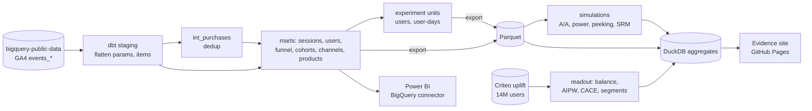

# Product Analytics and A/B Testing

[](https://github.com/AnuragBhandary/Product-Analytics-AB-Testing/actions/workflows/ci.yml)


**Dashboard:** https://anuragbhandary.github.io/Product-Analytics-AB-Testing/

Two questions about one online store: what do customers do, and can you trust an A/B test?

1. **Product analytics on GA4.** Google's public GA4 ecommerce export (4.3M events, 270k users)
   modelled in **BigQuery with dbt**: sessions, checkout funnel, weekly retention cohorts,
   channels and products. The tests reconcile revenue to the cent against an independent
   deduplication of the raw events.
2. **Experimentation.** A statistics toolkit (SRM, power, CUPED/CUPAC, delta method,
   sequential tests, multiple testing, doubly robust estimation). It is validated by thousands
   of simulated experiments on real GA4 users, then used to read out a **real 14M-user
   randomised experiment** (Criteo's incrementality test).

**Stack:** BigQuery · dbt · SQL · Python (NumPy, SciPy, scikit-learn, DuckDB) · Evidence ·
Power BI (DAX) · GitHub Actions + Pages

### Findings

| | |
|---|---|
| Criteo: SRM check | passes (85.00001% vs designed 85%) |
| Criteo: covariate balance | **fails**: features up to 63 standard errors apart; assignment predictable (AUC 0.509, z = 42) |
| Criteo: visit lift | naive **+27.1%** → doubly robust **+19.5%** (four adjusted estimators: +19.2% to +20.5%) |
| Criteo: conversion lift | naive +59.4% → doubly robust +51.8% |
| Criteo: who responds | top decile of baseline propensity = 63% of incremental visits, 82% of conversions |
| Peeking daily for 62 days | 29.7% false positives (naive) vs 1.5% (mSPRT, which stops at day 18 on a real +25% lift) |
| Days to detect +10% at the store's traffic | revenue/user **190**, purchaser rate 72, add-to-cart rate **17** |
| CUPED on GA4 | removes 0.24% of variance: 97% of test users are new |
| A lost-users bug (2% of treatment) | SRM alarm 100%; unchecked, a fake +4.3% conversion lift |
| GA4 data issues caught | 314 duplicated purchases (6.3% of revenue); 26% of sessions without a source (mostly bounces) |
| dbt | 13 models, 27 data tests (reconciliation, volume, funnel monotonicity), about 60 s on BigQuery |

Details: **[docs/RESULTS.md](docs/RESULTS.md)** · why each choice: **[docs/DESIGN.md](docs/DESIGN.md)**
· how to study and defend it: **[docs/INTERVIEW.md](docs/INTERVIEW.md)**

## Architecture



## Run it

Needs [uv](https://docs.astral.sh/uv/), Node 18+, a Google account with a free BigQuery
sandbox project, and the gcloud CLI.

```bash
gcloud auth application-default login
make install
make criteo-data criteo          # 311 MB download; readout in ~50 s on 4 threads
GCP_PROJECT=<your-project> make dbt export
make simulate dashboard-data dashboard
```

The Criteo and simulation steps cap themselves at 4 threads and run at low priority; the
GA4 SQL runs in BigQuery.

## Layout

| Path | |
|---|---|
| `dbt/` | BigQuery models, macros (`ga4_param`, `channel_group`), schema and singular tests |
| `src/ablab/stats.py` | the statistics, from formulas |
| `src/ablab/criteo.py` | the real experiment readout |
| `src/ablab/simulate.py` | testing the tests on GA4 users |
| `dashboard/` | Evidence pages (SQL + Markdown) |
| `powerbi/` | Power BI build guide, `measures.dax`, CSV extracts |
| `docs/results/` | raw JSON results behind every number |

## Tests

```bash
make check    # ruff, mypy --strict, sqlfluff, 33 tests (93% coverage)
```

## Data and licence

GA4 obfuscated sample ecommerce dataset (Google, BigQuery public datasets). Criteo Uplift
Prediction Dataset v2.1 (Diemert et al., AdKDD 2018), CC BY-NC-SA 4.0, not redistributed here.
Code: MIT.
