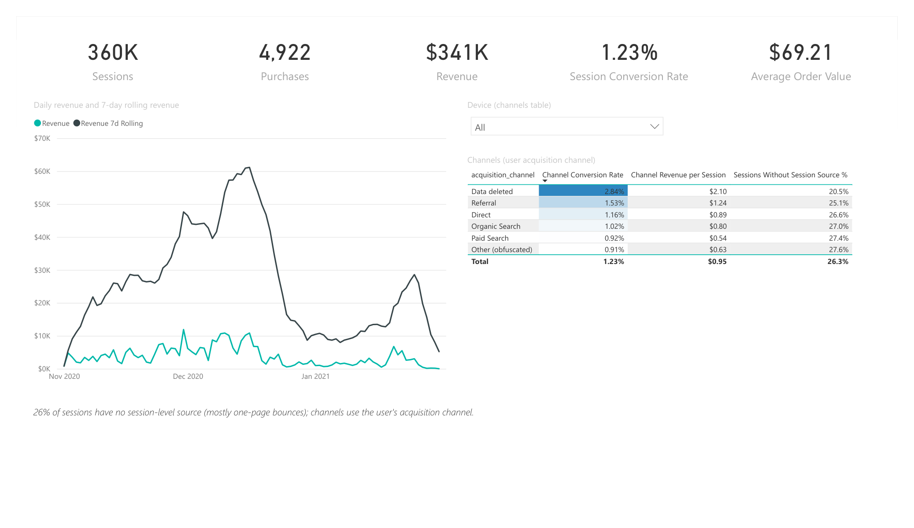
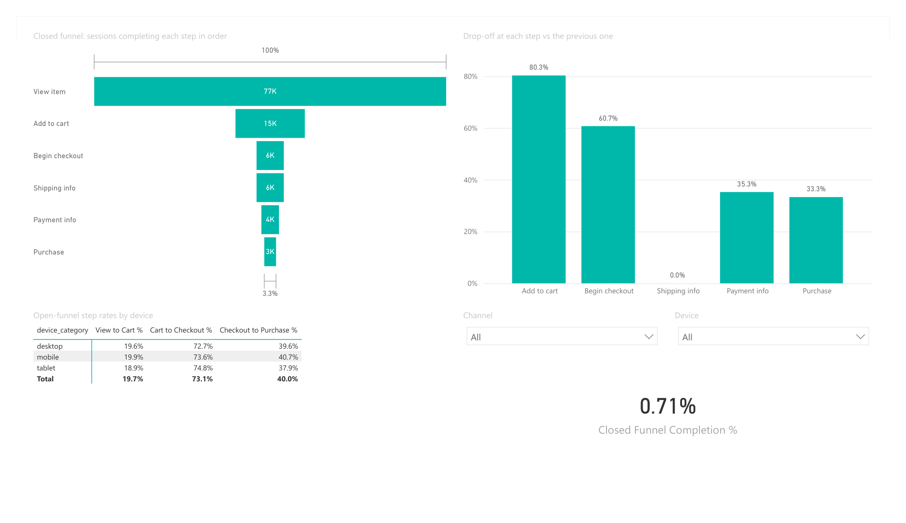
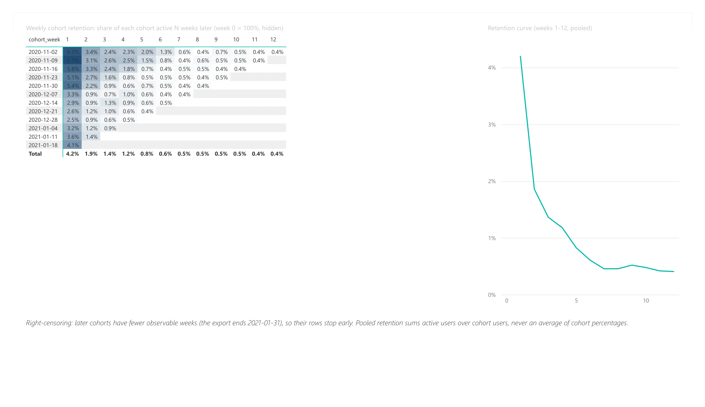
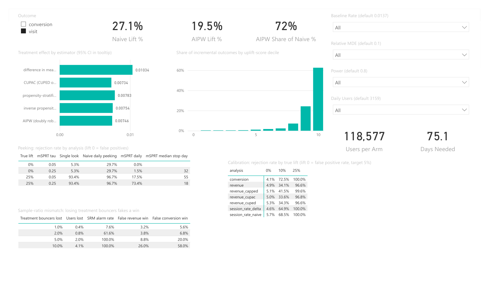

# Power BI report: build guide

The dashboard in `dashboard/` (Evidence) is built from code. This report is the same analysis
in Power BI Desktop (Windows only), reading the same dbt marts. The steps below are the manual
build; the committed report was generated from them as code (see "The built report").
Time: about 1.5 to 2 hours. Save the result as `powerbi/ga4-ab-testing.pbix` and export a PDF
(File > Export > PDF) to `powerbi/ga4-ab-testing.pdf`, plus one PNG screenshot per page in
`powerbi/screenshots/`.

Five pages: Overview, Funnel, Retention, Products, Experiment.

**The built report:** [`ga4-ab-testing/`](ga4-ab-testing) (Power BI project: open
`ga4-ab-testing.pbip`; saved as `.pbip` rather than `.pbix` so the model and measures diff as
text), [`ga4-ab-testing.pdf`](ga4-ab-testing.pdf), and one PNG per page in
[`screenshots/`](screenshots). It reads the CSVs in `powerbi/data/` (option B) straight from
GitHub, so a fresh clone refreshes with nothing to configure (choose **Anonymous** the first time
Power BI asks how to access the web content). To read local copies instead, edit `DataFolder` and
the `Source` steps in Transform data. The project was first generated from code by
[`tools/powerbi`](../tools/powerbi), then refreshed, tested and saved in Power BI Desktop.

| Overview | Funnel |
|---|---|
|  |  |
| **Retention** | **Experiment** |
|  |  |

What differs from the steps below, and why:

- **`Funnel Step Drop-off %` clears `FunnelStep` first** (`FILTER ( ALL ( FunnelStep ), ...)`).
  The visual filters `Step` (and `Order`, its sort column), so replacing only the `Order` filter
  left `Step` = the current step and found no previous row: every step read 100%.
- **An `Outcome` table** (visit, conversion) is related to both `criteo_estimates` and
  `criteo_segments`, so one slicer drives the cards, the estimates and the segments chart.
- **The `Date` table starts 2020-10-26**, the first funnel week, so no funnel row is orphaned.
- **Retention matrix shows weeks 1-12**: week 0 is 100% by definition and swamps the colour scale.
- **Products shows sessions viewed, not units added to cart.** `units_added_to_cart` in
  `mart_product_performance` has impossible values (2,343,435,712 for Google Utility BackPack;
  102,292 adds from 52,758 views for Super G Unisex Joggers), from junk `quantity` values in the
  GA4 sample. To fix in dbt (cap or null the quantity) before using that column.
- Estimator confidence intervals are in the bar tooltip rather than error bars; the sample-size
  inputs are single-select dropdowns. At the defaults the calculator gives 118,577 users per arm
  and 75.1 days.

## 1. Get the data

**Option A: BigQuery (preferred, shows the live connection).**

1. Home > Get data > More > Google BigQuery > Connect. Sign in with the Google account that
   owns project `ab-analytics-511119`.
2. Expand `ab-analytics-511119` > `ga4_marts` and tick: `mart_daily_kpis`,
   `mart_funnel_weekly`, `mart_channel_performance`, `mart_cohort_retention`,
   `mart_product_performance`. Load (Import mode, not DirectQuery: the tables are tiny and
   Import keeps working after the sandbox tables expire).
3. The sandbox deletes tables 60 days after they are created. If they are gone, run
   `make dbt` on the Mac first (one minute), or use option B.

**Option B: CSV.** Home > Get data > Text/CSV, one file at a time from `powerbi/data/`.

Either way, also load these CSVs from `powerbi/data/` (they are analysis results, not marts):
`criteo_estimates.csv`, `criteo_segments.csv`, `criteo_balance.csv`, `sim_calibration.csv`,
`sim_metric_sensitivity.csv`, `sim_peeking.csv`, `sim_srm.csv`.

Check in Power Query (Transform data) that `date`, `week` and `cohort_week` columns are type
Date, and rates are Decimal number.

## 2. Date table and relationships

1. Modeling > New table:
   ```DAX
   Date = CALENDAR ( DATE ( 2020, 11, 1 ), DATE ( 2021, 1, 31 ) )
   ```
   Add columns `Week = 'Date'[Date] - WEEKDAY ( 'Date'[Date], 3 )` (Monday-start) and
   `Month = FORMAT ( 'Date'[Date], "yyyy-mm" )`. Mark as date table (Table tools > Mark as
   date table > `Date`).
2. Model view: `Date[Date]` 1→* `mart_daily_kpis[date]`, and `Date[Date]` 1→*
   `mart_funnel_weekly[week]` (single direction).
3. The other tables stay unrelated; each page uses one of them.

## 3. Measures

Home > Enter data > name the table `_Measures` > Load. Then add every measure in
`measures.dax` to it (Modeling > New measure, paste one at a time) and set the format noted in
the comment above each. Delete the dummy column so `_Measures` shows as a measure table.

## 4. Funnel helper table

Home > Enter data, table `FunnelStep`:

| Order | Step |
|---|---|
| 1 | View item |
| 2 | Add to cart |
| 3 | Begin checkout |
| 4 | Shipping info |
| 5 | Payment info |
| 6 | Purchase |

Select `Step`, Column tools > Sort by column > `Order`.

## 5. Pages

**Overview**
- Cards: Sessions, Purchases, Revenue, Session Conversion Rate, Average Order Value.
- Line chart: X `Date[Date]`, Y `Revenue` and `Revenue 7d Rolling`.
- Table: `mart_channel_performance[acquisition_channel]`, `Channel Conversion Rate`,
  `Channel Revenue per Session`, `Sessions Without Session Source %`. Conditional formatting
  (background, gradient) on conversion rate.
- Slicer: `mart_channel_performance[device_category]`.
- Text box: "26% of sessions have no session-level source (mostly one-page bounces); channels
  use the user's acquisition channel."

**Funnel**
- Funnel visual: Category `FunnelStep[Step]`, Values `Funnel Step Sessions`.
- Clustered column: X `FunnelStep[Step]`, Y `Funnel Step Drop-off %`.
- Matrix: rows `mart_funnel_weekly[device_category]`, values `View to Cart %`,
  `Cart to Checkout %`, `Checkout to Purchase %`.
- Slicers: `mart_funnel_weekly[channel]`, `mart_funnel_weekly[device_category]`.

**Retention**
- Matrix: rows `mart_cohort_retention[cohort_week]` (Date hierarchy off), columns
  `week_number`, values `Retention %`. Conditional formatting > Background color > gradient
  white to dark blue. Filter `week_number` 0 to 12.
- Line chart: X `week_number` (1 to 12), Y `Retention %`.
- Text box: right-censoring note (later cohorts have fewer observable weeks).

**Products**
- Bar chart: Y `item_name`, X `Item Revenue`, visual filter `Item Revenue Rank` ≤ 15.
- Table: item, category, views, units added to cart, units purchased, `Item Revenue`,
  `Units per Viewing Session`; search via the visual header filter.
- Drill-through: make a hidden page "Item detail" with `item_name` as a drill-through field
  and cards for each column, so right-click > Drill through works from the bar chart.

**Experiment**
- Cards: `Naive Lift %`, `AIPW Lift %`, `AIPW Share of Naive %` with a slicer on
  `criteo_estimates[outcome]` (single select, default "visit").
- Clustered bar: Y `criteo_estimates[estimator]`, X `Effect`; Analytics pane > Error bars >
  upper `Effect CI High`, lower `Effect CI Low`. Sort by `estimator_order`.
- Column chart: X `criteo_segments[segment]`, Y `Share of Incremental`, slicer on outcome.
- Table from `sim_peeking`: true lift, tau, single look, naive daily, mSPRT daily, stop day.
- Table from `sim_srm`.
- Sample-size calculator (section 6).

## 6. Sample-size calculator (what-if parameters)

Modeling > New parameter > Numeric range, four times (tick "Add slicer to this page"):

| Name | Min | Max | Increment | Default |
|---|---|---|---|---|
| Baseline Rate | 0.001 | 0.2 | 0.001 | 0.0137 |
| Relative MDE | 0.01 | 0.5 | 0.01 | 0.1 |
| Power | 0.5 | 0.95 | 0.05 | 0.8 |
| Daily Users | 500 | 20000 | 100 | 3159 |

Each creates a `... Value` measure that `Users per Arm` and `Days Needed` use. Add two cards.
Check: baseline 0.0137 (GA4 purchaser rate), MDE 10%, power 0.8 should give about 118,500
users per arm and about 75 days, matching `ablab.stats.required_n_proportion` (the
simulation table says 72 days because it assumes equal variance in both arms).

## 7. Finish

- Theme: View > Themes > pick one and keep colours consistent across pages.
- Page navigator buttons on each page (Insert > Buttons > Navigator > Page navigator).
- Save `powerbi/ga4-ab-testing.pbix`, export the PDF, take screenshots, commit them.

What to say in an interview: the report reads the same tested dbt marts as the code-built
dashboard; the DAX keeps rates as ratios of sums (never averages of rates); the experiment page
shows why the naive lift is wrong and how many days a test needs.
